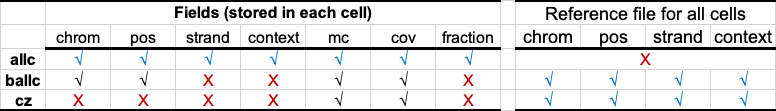
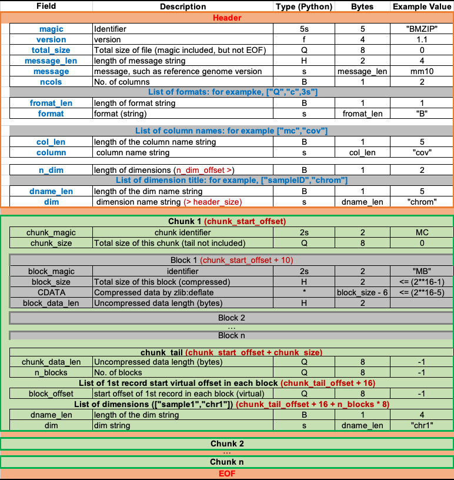

# cytozip: index-free, chunk-compressed storage for scalable single-cell DNA methylation analysis
[](https://anaconda.org/bioconda/cytozip)
[](https://anaconda.org/bioconda/cytozip)
[](https://anaconda.org/bioconda/cytozip)

A scalable, cloud-native ecosystem for single-cell and population DNA methylation analysis
## Installation
### conda
https://anaconda.org/bioconda/cytozip
```shell
mamba install -c wubinding -c bioconda -c conda-forge cytozip
# or
conda install -c wubinding -c bioconda -c conda-forge cytozip
# -c wubinding is optional, which may be the latest version
# keep -c conda-forge: without it the solver can pick bioconda's ancient
# anndata-0.6.22 (ModuleNotFoundError: No module named 'pandas.core.index')
```

### pip
```shell
# Prerequisites (one of):
conda install -c bioconda htslib libdeflate samtools         # recommended (Linux & macOS)
# apt-get install libhts-dev libdeflate-dev samtools          # Debian/Ubuntu
# brew install libdeflate htslib samtools libomp              # macOS (Homebrew)
pip install cytozip
# or reinstall
pip uninstall -y cytozip && pip install git+http://github.com/DingWB/cytozip

```

### Supported platforms
| | Linux | macOS (Intel / Apple Silicon) | Windows |
|---|---|---|---|
| conda / pip install | yes | yes | not supported natively (use WSL) |
| multi-threaded inflate / DMR (OpenMP) | gcc | conda-forge clang + `llvm-openmp`, or Homebrew `libomp`; plain Apple clang builds a single-threaded fallback | – |
| `bam_to_cz` fast htslib backend | yes | yes (htslib from conda/Homebrew); otherwise falls back to `samtools mpileup` | – |

On macOS `setup.py` probes the compiler: with conda-forge compilers (`conda install c-compiler llvm-openmp`)
or Homebrew `libomp` the extensions are built with OpenMP; with stock Apple clang they build without it
(`prange` loops run serially) — everything still works, only block inflate and DMR permutation run on one core.
Windows is not supported because `pysam` / `htslib` / `samtools` have no Windows builds; use WSL2.

## Implementation
|                                  | allcools | ballcools | cytozip |
| -------------------------------- | -------- | --------- | ----- |
| Format                           | .tsv.gz  | .ballc    | .cz   |
| Compression algorithm            | bgzip    | bgzip     | cytozip |
| Support Random Access ?          | Yes      | Yes       | Yes   |
| Need extra index file for query? | Yes      | yes       | No    |
| Quickly Merge?                   | No       | No        | Yes   |


<!---

-->
## Usage

[Documentation](https://dingwb.github.io/cytozip)

## Example dataset

[https://figshare.com/articles/dataset/cytozip_example_data/32095567](https://figshare.com/articles/dataset/cytozip_example_data/32095567)
